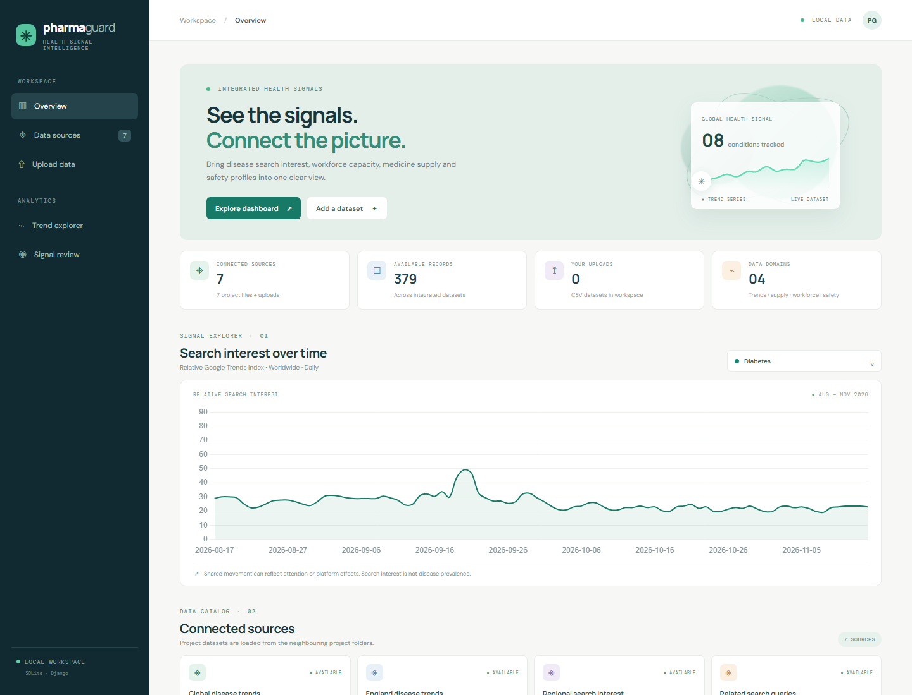

# PharmaGuard interface preview

**Live preview:** https://masterj23s25j27-sys.github.io/PHARMAGUARD-INTERFACE-PREVIEW/

This public repository contains only the static, read-only dashboard interface, the screenshot below, and an aggregate trend snapshot used by its chart. CSV uploads, database storage, and local source reads run in the separate Django project.

## Run locally

Open `index.html` through a static web server to try the disease selector and chart. To use the complete Django application, follow the setup instructions in the private PharmaGuard project repository.
